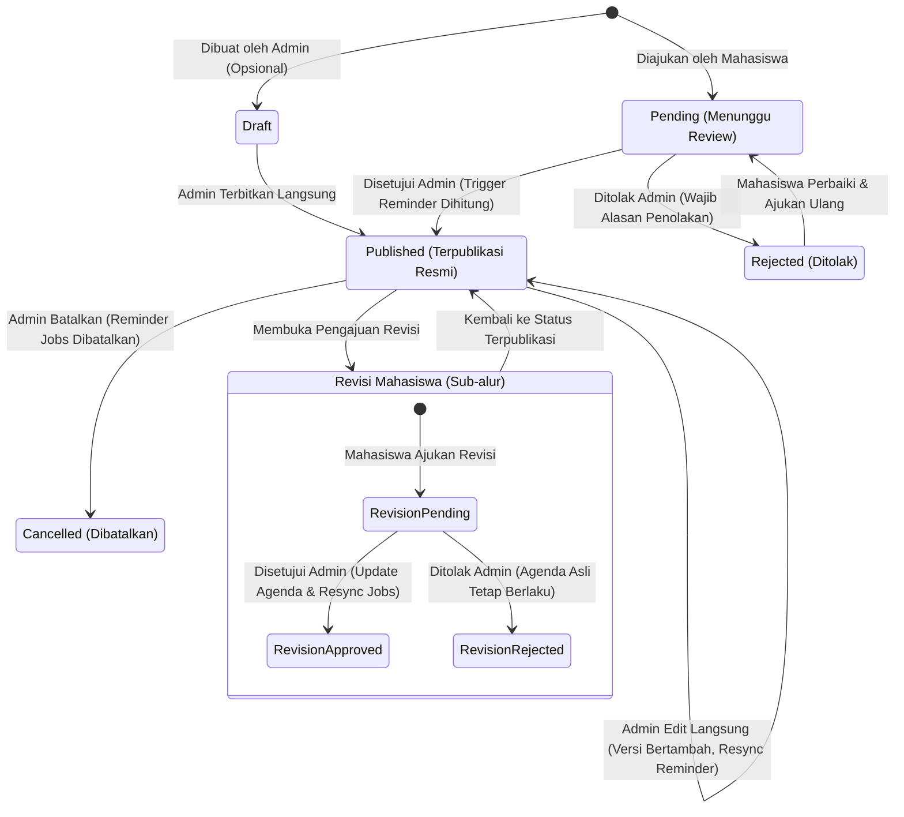

# State Machine & Lifecycle Agenda Akademik

> **Status:** Approved Baseline State Machine  
> **Source of Truth:** MASTER_PROMPT.md V3.2 (Section 6)

---

## 1. Diagram State Machine Agenda

---

## 2. Transisi State & Efek Samping (Side Effects)

| Dari Status | Menuju Status | Pelaku | Kondisi & Validasi | Efek Samping Sistem & Reminder |
|---|---|---|---|---|
| **[Baru]** | `pending` | Student | Form pengajuan valid (`title`, `category`, `scope`, target, `deadline` opsional). | Record `agendas` berstatus `pending`. Reminder **TIDAK** dibuat. Tampil di `Pengajuan Saya`. |
| **[Baru]** | `published` | Admin | Input valid dari admin workspace. | Record `agendas` langsung `published`. 4 trigger reminder dihitung dan di-insert ke `reminder_jobs`. |
| `pending` | `published` | Admin | Admin menyetujui pengajuan di panel review. | Versi diset `1`. Hitung 4 trigger reminder (H-7, H-3, H-1, T-3 Jam) berdasarkan deadline. Lewati trigger masa lalu. Notifikasi student terkirim. |
| `pending` | `rejected` | Admin | Admin menolak pengajuan dengan alasan wajib (`notes`). | Catat penolakan di `agenda_reviews`. Reminder **TIDAK** dibuat. Notifikasi penolakan ke student. |
| `published` | `published` (Edit) | Admin | Form edit valid. | Versi dinaikkan (`version = version + 1`). Catat audit log. Sinkronisasi transaksional: batalkan job lama yang belum dieksekusi, jadwalkan ulang job baru sesuai deadline baru. |
| `published` | `cancelled` | Admin | Konfirmasi pembatalan dari admin. | Status diubah menjadi `cancelled`. Semua `reminder_jobs` dengan status `queued` untuk agenda ini diubah menjadi `cancelled`. Tidak ada pesan baru dikirim. |

---

## 3. Alur Revisi Pengajuan Mahasiswa
Untuk menjaga stabilitas kalender publik:
1. Ketika agenda telah `published`, mahasiswa tidak dapat mengubah isi agenda secara langsung.
2. Mahasiswa dapat mengajukan **revisi** melalui form revisi (misal: "Dosen memundurkan deadline ke Jumat").
3. Data perubahan tersimpan di tabel `agenda_revisions` dengan status `pending`.
4. **Agenda resmi tetap tampil kepada seluruh angkatan dengan data aslinya** sampai admin memverifikasi.
5. Jika admin menyetujui revisi:
   - Data `agendas` diperbarui dengan nilai baru.
   - Versi dinaikkan.
   - Pemicu reminder disinkronkan ulang secara otomatis.
6. Jika admin menolak revisi:
   - Status revisi diset `rejected` beserta alasan. Agenda resmi tidak mengalami perubahan.
