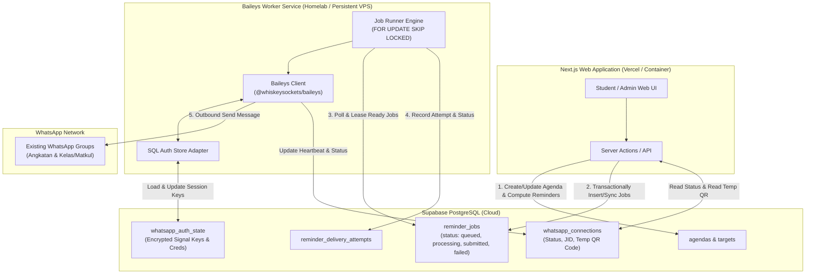

# System Architecture & Technical Design — Novarion Academic Hub V3

> **Status:** Approved Baseline Architecture  
> **Source of Truth:** MASTER_PROMPT.md V3.2

---

## 1. Topologi Monorepo & Pembagian Layanan

Proyek menggunakan arsitektur **npm workspace monorepo** yang memisahkan aplikasi web modern dengan service background WhatsApp worker untuk menjaga keandalan dan portabilitas server:

```
statistika-academic-hub/
├── apps/
│   ├── web/                     # Next.js 14+ (App Router), TypeScript, Tailwind CSS, Shadcn-like primitives
│   │   ├── app/                 # Routes: (public), app (student), admin
│   │   ├── components/          # Reusable UI library (Hybrid Design)
│   │   ├── lib/                 # Auth guards, Supabase clients, action utilities
│   │   └── actions/             # Next.js Server Actions (Zod validated, role-checked)
│   └── worker/                  # Node.js 20+ persistent service (Baileys WhatsApp Gateway + Job Runner)
│       ├── src/
│       │   ├── baileys/         # Baileys client wrapper, event handlers, QR management
│       │   ├── auth/            # SQL-backed encrypted SignalKeyStore & AuthenticationState
│       │   ├── runner/          # Reminder job polling engine (FOR UPDATE SKIP LOCKED)
│       │   └── providers/       # MessagingProvider interface & MockMessagingProvider
│       └── Dockerfile           # Production container for homelab / self-hosted node
├── packages/
│   ├── db/                      # Drizzle ORM Schema, Client, Migrations, Seeds
│   │   ├── src/schema/          # Modul domain: auth, academics, agendas, knowledge, messaging, reminders
│   │   ├── migrations/          # SQL migrations generated by drizzle-kit
│   │   └── seeds/               # Seed bootstrap admin & initial academic structure
│   └── shared/                  # Common TypeScript types, Zod schemas, WIB date utilities
├── docs/                        # Complete design & specification documents
├── docker-compose.yml           # Local & Homelab deployment orchestration
└── .env.example                 # Environment variables specification
```

---

## 2. Pola Komunikasi Web–Worker (Database as Message Broker)

Sistem mengadopsi prinsip **Zero Public Inbound Ports** untuk worker WhatsApp. Worker di homelab tidak membuka port web publik:



### 2.1 Alur Kerja Reminder
1. Saat admin/moderator menerbitkan agenda (`status = 'published'`), sistem menghitung empat trigger: **H-7, H-3, H-1 (08.00 WIB)** dan **T-3 JAM**.
2. Record `reminder_jobs` dibuat dengan status `queued` dan `scheduled_for` UTC. Trigger yang sudah lewat dilewati secara otomatis.
3. Worker melakukan polling secara periodik (setiap 30–60 detik) menggunakan query:
   ```sql
   SELECT id, agenda_id, channel_id, trigger_type, scheduled_for
   FROM reminder_jobs
   WHERE status = 'queued' AND scheduled_for <= NOW()
   ORDER BY scheduled_for ASC
   FOR UPDATE SKIP LOCKED
   LIMIT 10;
   ```
4. Worker menandai job sebagai `processing`, memverifikasi ulang status agenda (apakah masih `published` dan belum `cancelled`), menyusun pesan, dan mengirimkan pesan outbound ke JID grup WhatsApp.
5. Hasil pengiriman dicatat dalam `reminder_delivery_attempts`. Status job diubah menjadi `submitted` atau `failed` (dengan exponential backoff). Jika outcome ambigu (misal timeout soket), status diset ke `unknown` untuk investigasi admin dan menghindari double-send.

### 2.2 Alur Pairing WhatsApp & Penyimpanan Sesi Persisten
1. Admin membuka menu **Admin → WhatsApp Gateway**.
2. Worker yang belum terautentikasi membangkitkan QR code dan menyimpannya ke tabel `whatsapp_connections` dengan TTL 60 detik.
3. Halaman admin menampilkan QR sementara secara real-time.
4. Admin memindai QR sekali saja menggunakan akun WhatsApp khusus Novarion.
5. Worker menangani event `connection.update` dan `creds.update`:
   - Menyimpan credentials dan Signal protocol keys ke tabel `whatsapp_auth_state`.
   - Data kunci dienkripsi menggunakan AES-256-GCM dengan kunci master dari environment worker (`WA_SESSION_ENCRYPTION_KEY`).
6. Setelah tersambung, status diubah menjadi `connected`, QR code dihapus dari database.
7. **Saat worker restart**: Worker memuat auth state dari PostgreSQL, mendekripsi Signal keys, dan menyambung ulang secara otomatis tanpa meminta scan QR baru.

---

## 3. Ketahanan Sistem (Resilience & Decoupling)

- **Worker Offline**: Aplikasi web tetap 100% berjalan normal untuk kalender mahasiswa, materi, pengajuan, dan admin workspace. Status WhatsApp di admin menampilkan indikator akurat `disconnected` beserta timestamp terakhir.
- **Job Recovery**: Jika worker mati di tengah pemrosesan job (`processing`), sistem mendeteksi expired lease (misal > 5 menit) dan mengembalikan status ke `queued` secara aman.
- **Emergency Kill Switch**: Admin dapat mengaktifkan `is_paused = true` pada tabel `whatsapp_connections`. Saat aktif, worker menghentikan seluruh pengiriman pesan secara instan.
