# Entity Relationship Diagram (ERD) & Schema Design

> **Status:** Approved Baseline ERD  
> **Source of Truth:** MASTER_PROMPT.md V3.2 (Section 11)

---

## 1. Visualisasi Mermaid ERD

```mermaid
erDiagram
    %% IDENTITAS & WHITELIST
    student_whitelist {
        uuid id PK
        varchar nim UK
        varchar email UK
        varchar full_name
        varchar role "student | admin"
        boolean is_active
        timestamp created_at
        timestamp updated_at
    }

    profiles {
        uuid id PK "Matches auth.users.id"
        varchar nim UK "References student_whitelist.nim"
        varchar email UK
        varchar full_name
        varchar role "student | admin"
        varchar avatar_url
        timestamp created_at
        timestamp updated_at
    }

    %% STRUKTUR AKADEMIK
    academic_terms {
        uuid id PK
        varchar code UK "Contoh: 2026-GANJIL"
        varchar name "Contoh: Semester Ganjil 2026/2027"
        date start_date
        date end_date
        boolean is_active
        timestamp created_at
    }

    courses {
        uuid id PK
        varchar code UK "Contoh: STAT101"
        varchar name "Contoh: Analisis Regresi Terapan"
        integer credits
        timestamp created_at
    }

    course_offerings {
        uuid id PK
        uuid term_id FK
        uuid course_id FK
        timestamp created_at
    }

    class_sections {
        uuid id PK
        uuid offering_id FK
        varchar name "Contoh: Kelas A, Kelas B"
        timestamp created_at
    }

    study_groups {
        uuid id PK
        uuid class_section_id FK
        varchar name "Contoh: Kelompok Praktikum 1"
        timestamp created_at
    }

    enrollments {
        uuid id PK
        uuid profile_id FK
        uuid class_section_id FK
        timestamp created_at
    }

    study_group_members {
        uuid id PK
        uuid profile_id FK
        uuid study_group_id FK
        timestamp created_at
    }

    %% AGENDA & TUGAS
    agendas {
        uuid id PK
        varchar title
        text description
        varchar category "tugas | kuis | ujian | praktikum | kuliah | kegiatan | pengumuman"
        varchar scope "angkatan | mata_kuliah | kelas | kelompok"
        timestamp start_time
        timestamp deadline
        varchar location_or_link
        text source_reference
        uuid created_by FK
        varchar status "pending | published | rejected | cancelled"
        integer version
        timestamp created_at
        timestamp updated_at
    }

    agenda_targets {
        uuid id PK
        uuid agenda_id FK
        uuid course_id FK "nullable"
        uuid class_section_id FK "nullable"
        uuid study_group_id FK "nullable"
    }

    agenda_revisions {
        uuid id PK
        uuid agenda_id FK
        varchar proposed_title
        text proposed_description
        timestamp proposed_deadline
        text change_reason
        uuid submitted_by FK
        varchar status "pending | approved | rejected"
        timestamp reviewed_at
        uuid reviewed_by FK
        timestamp created_at
    }

    agenda_reviews {
        uuid id PK
        uuid agenda_id FK
        uuid reviewer_id FK
        varchar action "approved | rejected | revision_requested"
        text notes
        timestamp created_at
    }

    personal_tasks {
        uuid id PK
        uuid profile_id FK
        varchar title
        text description
        timestamp deadline
        varchar status "todo | done"
        timestamp completed_at
        timestamp created_at
        timestamp updated_at
    }

    shared_task_completions {
        uuid id PK
        uuid agenda_id FK
        uuid profile_id FK
        varchar status "todo | done"
        timestamp completed_at
        timestamp created_at
    }

    %% MATERI & KNOWLEDGE
    knowledge_items {
        uuid id PK
        varchar title
        varchar slug UK
        text content
        varchar category "faq | guide | important_link | reference"
        varchar status "draft | published | archived"
        uuid created_by FK
        timestamp created_at
        timestamp updated_at
    }

    knowledge_assets {
        uuid id PK
        varchar title
        text description
        varchar asset_type "file_upload | external_link"
        varchar file_path "Supabase Storage Path"
        varchar external_url
        integer file_size
        varchar mime_type
        uuid term_id FK "nullable"
        uuid course_id FK "nullable"
        uuid class_section_id FK "nullable"
        varchar status "draft | published | archived"
        uuid created_by FK
        timestamp created_at
        timestamp updated_at
    }

    %% MESSAGING & WHATSAPP GATEWAY
    whatsapp_connections {
        uuid id PK
        varchar phone_number
        varchar display_name
        varchar status "connected | connecting | disconnected | requires_repair | error"
        text temp_qr_code
        timestamp qr_expires_at
        boolean is_paused "Emergency Kill Switch"
        timestamp last_connected_at
        timestamp last_heartbeat_at
        text last_error
        timestamp updated_at
    }

    whatsapp_auth_state {
        varchar key PK
        text encrypted_data "AES-256-GCM"
        varchar iv
        varchar tag
        timestamp updated_at
    }

    messaging_channels {
        uuid id PK
        varchar jid UK "WhatsApp Group JID"
        varchar name "Nama Grup"
        boolean is_active
        boolean verified_by_admin
        timestamp created_at
        timestamp updated_at
    }

    channel_routes {
        uuid id PK
        uuid channel_id FK
        varchar scope "angkatan | mata_kuliah | kelas | kelompok"
        uuid course_id FK "nullable"
        uuid class_section_id FK "nullable"
        uuid study_group_id FK "nullable"
        boolean is_active
        timestamp created_at
    }

    %% REMINDER ENGINE
    reminder_rules {
        uuid id PK
        varchar trigger_type "h_7 | h_3 | h_1 | t_minus_3h"
        varchar description
        boolean is_active
    }

    reminder_jobs {
        uuid id PK
        uuid agenda_id FK
        uuid channel_id FK
        varchar trigger_type "h_7 | h_3 | h_1 | t_minus_3h"
        timestamp scheduled_for
        varchar status "queued | processing | submitted | failed | unknown | cancelled"
        integer attempt_count
        timestamp locked_until
        varchar locked_by "Worker ID Lease"
        text last_error
        timestamp created_at
        timestamp updated_at
    }

    reminder_delivery_attempts {
        uuid id PK
        uuid job_id FK
        varchar provider "baileys | mock"
        varchar provider_message_id
        varchar status "submitted | failed | unknown"
        text response_payload
        text error_message
        timestamp attempted_at
    }

    %% OPERASIONAL & AUDIT
    import_runs {
        uuid id PK
        uuid executed_by FK
        varchar file_name
        integer total_rows
        integer success_rows
        integer error_rows
        jsonb error_summary
        timestamp created_at
    }

    audit_logs {
        uuid id PK
        uuid actor_id FK "nullable"
        varchar action
        varchar entity_type
        uuid entity_id
        jsonb old_values
        jsonb new_values
        varchar ip_address
        timestamp created_at
    }

    app_notifications {
        uuid id PK
        uuid profile_id FK
        varchar title
        text message
        varchar link
        boolean is_read
        timestamp created_at
    }

    %% RELATIONSHIPS
    student_whitelist ||--o| profiles : "links to NIM"
    profiles ||--o{ enrollments : "enrolls"
    profiles ||--o{ study_group_members : "joins"
    profiles ||--o{ personal_tasks : "owns"
    profiles ||--o{ shared_task_completions : "tracks"
    profiles ||--o{ agendas : "creates"
    profiles ||--o{ audit_logs : "triggers"
    profiles ||--o{ app_notifications : "receives"

    academic_terms ||--o{ course_offerings : "contains"
    courses ||--o{ course_offerings : "offered as"
    course_offerings ||--o{ class_sections : "divided into"
    class_sections ||--o{ study_groups : "splits into"
    class_sections ||--o{ enrollments : "has students"
    study_groups ||--o{ study_group_members : "has members"

    agendas ||--o{ agenda_targets : "targeted to"
    agendas ||--o{ agenda_revisions : "has revisions"
    agendas ||--o{ agenda_reviews : "audited by"
    agendas ||--o{ shared_task_completions : "completed individually by"
    agendas ||--o{ reminder_jobs : "spawns"

    messaging_channels ||--o{ channel_routes : "routed for"
    messaging_channels ||--o{ reminder_jobs : "receives messages"
    reminder_jobs ||--o{ reminder_delivery_attempts : "logs attempts"
```

---

## 2. Kunci & Aturan Integritas Database

1. **Format Timestamp**: Semua field waktu di database menggunakan `timestamp with time zone` (UTC). Presentasi kalender dan kalkulasi jam operasional (08.00 WIB) dikonversi menggunakan timezone `Asia/Jakarta`.
2. **Deduplikasi Reminder**:
   - `reminder_jobs` memiliki composite index & unique constraint logis: `(agenda_id, channel_id, trigger_type)` untuk mencegah satu agenda memiliki job ganda dengan trigger dan grup yang sama.
3. **Data Isolasi Personal**:
   - `personal_tasks` dan `shared_task_completions` terikat secara ketat ke `profile_id`. Foreign key cascade delete memastikan kepatuhan saat pembersihan akun.
4. **Keamanan Kunci Baileys**:
   - Tabel `whatsapp_auth_state` **tidak boleh** memiliki policy RLS publik dan dilarang dapat diakses lewat client SDK Supabase. Hanya worker berizin server-side yang membaca/menulis tabel ini.
