# Information Architecture & Route Map

> **Status:** Approved Baseline Route Map  
> **Source of Truth:** MASTER_PROMPT.md V3.2 (Section 10B & 10C)

---

## 1. Peta Rute Aplikasi (Application Route Map)

```mermaid
graph TD
    Root["/ (Public Landing Page)"]
    Login["/login (Login Google OAuth)"]
    Invalid["/auth/invalid-account (Whitelist Mismatch 403)"]
    Privacy["/privacy (Kebijakan Privasi)"]

    subgraph Student["Student Workspace (/app/*)"]
        SDash["/app (Dashboard Mahasiswa)"]
        SCal["/app/calendar (Kalender Akademik)"]
        SAgendas["/app/agendas (Daftar Agenda)"]
        SAgendaNew["/app/agendas/new (Ajukan Agenda)"]
        SAgendaDetail["/app/agendas/:id (Detail Agenda)"]
        SSubmissions["/app/submissions (Pengajuan Saya)"]
        STasks["/app/tasks (Tugas & Checklist Saya)"]
        SMaterials["/app/materials (File Materi)"]
        SMaterialDetail["/app/materials/:id (Detail Materi)"]
        SKnowledge["/app/knowledge (Knowledge Hub)"]
        SKnowledgeDetail["/app/knowledge/:slug (Artikel/FAQ)"]
        SNotif["/app/notifications (Notifikasi)"]
        SAccount["/app/account (Profil & Akun)"]
    end

    subgraph Admin["Admin Workspace (/admin/*)"]
        ADash["/admin (Ringkasan Operasional)"]
        ASubmissions["/admin/submissions (Review Pengajuan)"]
        AAgendas["/admin/agendas (Kelola Agenda)"]
        AAcademics["/admin/academics (Struktur Akademik)"]
        AStudents["/admin/students (Mahasiswa & Whitelist)"]
        AImports["/admin/imports (Impor Data CSV)"]
        AMaterials["/admin/materials (Kelola Materi)"]
        AKnowledge["/admin/knowledge (Kelola Knowledge Hub)"]
        AWA["/admin/whatsapp (WhatsApp Gateway & QR)"]
        AWAGroups["/admin/whatsapp/groups (Mapping Grup)"]
        AReminders["/admin/reminders (Antrean & Log Reminder)"]
        AAudit["/admin/audit (Audit Trail)"]
    end

    Root --> Login
    Login --> Invalid
    Login --> SDash
    Login --> ADash
```

---

## 2. Struktur Navigasi Berdasarkan Peran

### 2.1 Navigasi Mahasiswa (Student)
- **Desktop (Sidebar Kiri)**:
  - 🏠 Dashboard (`/app`)
  - 📅 Kalender Akademik (`/app/calendar`)
  - 📋 Daftar Agenda (`/app/agendas`)
  - ✅ Tugas Saya (`/app/tasks`)
  - 📁 File Materi (`/app/materials`)
  - 💡 Knowledge Hub (`/app/knowledge`)
  - 📝 Pengajuan Saya (`/app/submissions`)
  - ⚙️ Akun (`/app/account`)
- **Mobile (Bottom Navigation - Maks 4 Titik Prioritas + Menu Lainnya)**:
  - `Beranda` (`/app`)
  - `Kalender` (`/app/calendar`)
  - `Tugas` (`/app/tasks`)
  - `Materi` (`/app/materials`)
  - `Lainnya` (Drawer: Knowledge Hub, Pengajuan, Akun)

### 2.2 Navigasi Admin Angkatan
- **Header Khusus**: Banner penanda jelas `Admin Workspace` + tombol pintas `Kembali ke Tampilan Mahasiswa`.
- **Sidebar Admin Terstruktur**:
  - **Operasional**: Ringkasan (`/admin`), Review Pengajuan (`/admin/submissions`), Kelola Agenda (`/admin/agendas`).
  - **Data Angkatan**: Struktur Akademik (`/admin/academics`), Mahasiswa & Whitelist (`/admin/students`), Impor CSV (`/admin/imports`).
  - **Konten**: Kelola Materi (`/admin/materials`), Knowledge Hub (`/admin/knowledge`).
  - **WhatsApp & Reminder**: WhatsApp Gateway (`/admin/whatsapp`), Pemetaan Grup (`/admin/whatsapp/groups`), Log Pengingat (`/admin/reminders`).
  - **Keamanan**: Audit Trail (`/admin/audit`).
