# Information Architecture & Route Map

> **Status:** Overhauled & Approved Architecture  
> **Source of Truth:** Novarion Academic Hub V3 Overhaul

---

## 1. Peta Rute Aplikasi (Application Route Map)

```mermaid
graph TD
    Root["/ (Public Landing Page — Editorial Community & Identity)"]
    Login["/login (Login NIM + Kata Sandi)"]
    ChangePwd["/auth/change-password (Wajib Ganti Password Pertama)"]
    Invalid["/auth/invalid-account (Whitelist Mismatch 403)"]
    Privacy["/privacy (Kebijakan Privasi)"]

    subgraph Student["Student Workspace (/app/*)"]
        SDash["/app (Dashboard Mahasiswa & Scope-filtered deadines)"]
        SCal["/app/calendar (Kalender Akademik & Custom HEX Colors)"]
        SAgendas["/app/agendas (Daftar Agenda & Delegated Create)"]
        SAgendaNew["/app/agendas/new (Ajukan / Buat Agenda)"]
        SSubmissions["/app/submissions (Pengajuan Saya)"]
        STasks["/app/tasks (Tugas & Checklist Saya)"]
        SMaterials["/app/materials (File Materi Perkuliahan)"]
        SKnowledge["/app/knowledge (Knowledge Hub & Searchable FAQ)"]
        SAccount["/app/account (Profil & Akun)"]
    end

    subgraph Admin["Admin Workspace (/admin/*)"]
        ADash["/admin (Ringkasan Operasional & Agregasi Cepat)"]
        AAgendas["/admin/agendas (Kelola Agenda + CSV Agenda)"]
        ASubmissions["/admin/submissions (Review Pengajuan)"]
        AAcademics["/admin/academics (Struktur Akademik + CSV Mapping)"]
        AMaterials["/admin/materials (File Materi)"]
        AKnowledge["/admin/knowledge (Knowledge Hub & FAQ Admin)"]
        AStudents["/admin/students (Data Mahasiswa + CSV Import)"]
        APermissions["/admin/permissions (Role & Granular Permission)"]
        ACms["/admin/website (Kelola Website CMS Terintegrasi)"]
        AWA["/admin/whatsapp (WhatsApp Gateway, Pairing, Grup, Log)"]
        AAudit["/admin/audit (Pengaturan & Audit Trail)"]
    end

    Root --> Login
    Login --> ChangePwd
    Login --> SDash
    Login --> ADash
```

---

## 2. Struktur Navigasi Berdasarkan Peran

### 2.1 Navigasi Mahasiswa (Student)
- **Desktop (Sidebar Kiri)**:
  - 🏠 Dashboard (`/app`)
  - 📅 Kalender Akademik (`/app/calendar`)
  - 📋 Daftar Agenda (`/app/agendas`)
  - ✅ Tugas Saya (`/app/tasks`)
  - 📁 File Materi (`/app/materials`)
  - 💡 Knowledge Hub & FAQ (`/app/knowledge`)
  - 📝 Pengajuan Saya (`/app/submissions`)
  - ⚙️ Akun (`/app/account`)
- **Agenda Manager Delegasi**:
  - Tombol aksi langsung "Buat Agenda Resmi" di Kalender dan Daftar Agenda (langsung `published` tanpa approval).

### 2.2 Navigasi Admin Workspace
- **BERANDA**:
  - Dashboard Operasional (`/admin`)
- **AKADEMIK**:
  - Kelola Agenda + CSV Agenda (`/admin/agendas`)
  - Pengajuan Agenda (`/admin/submissions`)
  - Struktur Akademik + CSV Mapping (`/admin/academics`)
  - File Materi (`/admin/materials`)
  - Knowledge Hub & FAQ (`/admin/knowledge`)
- **ANGKATAN**:
  - Data Mahasiswa + CSV Mahasiswa (`/admin/students`)
  - Role & Permission Granular (`/admin/permissions`)
- **WEBSITE**:
  - Kelola Website CMS (`/admin/website`) — Hero, Warta, Galeri, Prestasi, Media Library
- **SISTEM**:
  - WhatsApp & Reminder terpadu (`/admin/whatsapp` dengan tabs Gateway, Grup, Log)
  - Pengaturan & Audit Trail (`/admin/audit`)

