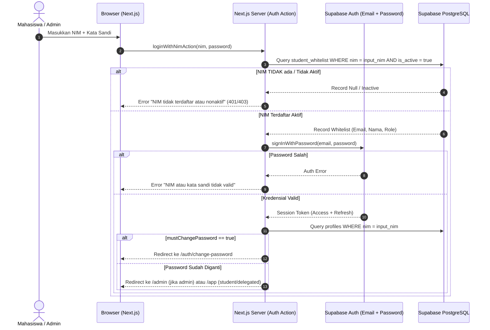

# Permission Matrix & Authorization Protocol

> **Status:** Overhauled & Approved Permissions  
> **Source of Truth:** Novarion Academic Hub V3 Overhaul

---

## 1. Alur Autentikasi NIM & Validasi Whitelist

---

## 2. Matriks Otorisasi Berdasarkan Peran & Izin Granular

| Domain Entitas | Tindakan / Endpoint | Student (Biasa) | Agenda Manager | Super Admin | Keterangan Aturan Server |
|---|---|:---:|:---:|:---:|---|
| **Autentikasi** | Login NIM + Password | ✅ | ✅ | ✅ | NIM divalidasi ke `student_whitelist`. Password pertama wajib diganti. |
| | Kelola Izin (`permissions.manage`) | ❌ DILARANG | ❌ DILARANG | ✅ | Super Admin dapat mendelegasikan izin granular dan scope. |
| **Data Mahasiswa** | Baca daftar mahasiswa & NIM | ❌ | ❌ | ✅ | Mahasiswa tidak dapat mengakses dump seluruh data angkatan. |
| | Impor CSV Data Mahasiswa | ❌ | ❌ | ✅ | Terletak di `/admin/students`, idempoten, tanpa reset password. |
| **Struktur Akademik** | Baca matkul/kelas terdaftar | ✅ | ✅ | ✅ | Filter data berbasis `getStudentAcademicScope`. |
| | Impor CSV Mapping Akademik | ❌ | ❌ | ✅ | Terletak di `/admin/academics`, mendukung repeated NIM multi-baris. |
| **Agenda Akademik** | Baca agenda terpublikasi | ✅ (Sesuai Scope) | ✅ (Sesuai Scope) | ✅ (Semua) | Memfilter agenda berdasarkan matkul, kelas, kelompok terdaftar. |
| | Ajukan agenda (`pending`) | ✅ | ✅ | ✅ | Menghasilkan status `pending` untuk direview. |
| | Publikasi agenda resmi | ❌ | ✅ (Sesuai Scope) | ✅ (Semua) | **Agenda Manager langsung mempublikasikan (`published`)** tanpa approval. |
| | Impor CSV Agenda | ❌ | ✅ (Sesuai Scope) | ✅ (Semua) | Terletak di `/admin/agendas`, idempoten via `external_id`. |
| | Edit/Cancel agenda resmi | ❌ | ✅ (Agenda Milik Sendiri) | ✅ (Semua) | Edit/cancel membatalkan atau menjadwalkan ulang antrean reminder. |
| **Tugas Pribadi** | CRUD tugas pribadi (`personal_tasks`)| ✅ (Milik Sendiri) | ✅ (Milik Sendiri) | ✅ (Milik Sendiri)| Isolasi ketat: tugas pribadi tidak memicu reminder grup WhatsApp. |
| **Knowledge Hub & FAQ** | Baca artikel FAQ & Panduan | ✅ | ✅ | ✅ | Progressive disclosure accordion dengan filter kategori dan pencarian. |
| | Kelola artikel (Create/Edit/Publish) | ❌ | ❌ (Kecuali ada izin) | ✅ | Status draft, published, archived di `/admin/knowledge`. |
| **Kelola Website CMS** | Hero, Warta, Galeri, Prestasi | ❌ DILARANG | ❌ DILARANG | ✅ | Terletak di `/admin/website`, strictly Super Admin only. |
| **WhatsApp Gateway** | Pairing & Status Baileys | ❌ DILARANG | ❌ DILARANG | ✅ | Menjaga sesi pairing aktif, non-negotiable H-7, H-3, H-1, T-3h. |
| | Emergency Kill Switch (Pause) | ❌ DILARANG | ❌ DILARANG | ✅ | Saklar darurat mematikan proses pengiriman reminder seketika. |
| **Audit Logs** | Baca Audit Trail | ❌ | ✅ | Riwayat perubahan sistem hanya untuk admin. |

---

## 3. Prinsip Keamanan Server-Side
1. **Zero Client Trust**: Nilai `role`, `nim`, atau `email` yang dikirim dari form/request body tidak pernah dipercaya sebagai bukti otorisasi. Seluruh Server Action mengambil konteks identitas dari session cookie Supabase yang didekripsi di server.
2. **Service Role Isolation**: Kunci Supabase `service_role` hanya digunakan di layer backend terisolasi (Server Actions / API / Worker) dan tidak pernah diekspos ke browser bundle (`NEXT_PUBLIC_`).
3. **Audit Trail**: Setiap tindakan administratif (persetujuan agenda, pembatalan, impor CSV, update whitelist, perubahan kill switch) wajib mencatat `actor_id`, `action`, `old_values`, `new_values`, dan `timestamp` ke tabel `audit_logs`.
