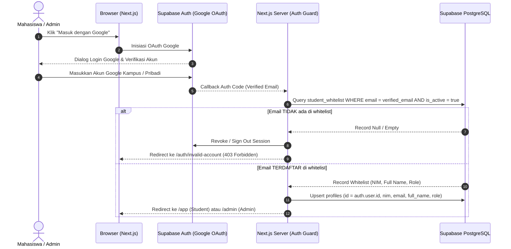

# Permission Matrix & Authorization Protocol

> **Status:** Approved Baseline Permissions  
> **Source of Truth:** MASTER_PROMPT.md V3.2 (Section 4 & 11)

---

## 1. Alur Autentikasi & Validasi Whitelist

---

## 2. Matriks Otorisasi Berdasarkan Peran

| Domain Entitas | Tindakan / Endpoint | Student (Mahasiswa) | Admin Angkatan | Keterangan Aturan Server |
|---|---|:---:|:---:|---|
| **Autentikasi** | Login Google | ✅ (Jika di Whitelist) | ✅ (Jika di Whitelist) | Email diverifikasi server terhadap `student_whitelist`. |
| | Elevasi Peran (Self-Promotion) | ❌ DILARANG | ❌ DILARANG | Admin pertama di-bootstrap via seed script di server. |
| **Whitelist & Roster** | Baca daftar mahasiswa & NIM | ❌ | ✅ | Student tidak boleh melihat dump seluruh data angkatan. |
| | CRUD Whitelist & Impor CSV | ❌ | ✅ | Hanya admin berhak melakukan mutasi data akademik. |
| **Struktur Akademik** | Baca matkul/kelas terdaftar | ✅ | ✅ | Student hanya melihat entitas tempat dirinya enroll. |
| | Kelola semester, matkul, kelas | ❌ | ✅ | Seluruh modifikasi struktur diaudit. |
| **Agenda Akademik** | Baca agenda terpublikasi | ✅ (Sesuai Scope) | ✅ (Semua Scope) | Student hanya membaca agenda angkatan + kelas terdaftar. |
| | Ajukan agenda baru (`pending`) | ✅ | ✅ (Langsung Published) | Pengajuan student wajib melalui review admin. |
| | Review / Approve / Reject agenda | ❌ | ✅ | Penolakan wajib menyertakan alasan (`notes`). |
| | Ubah / Batalkan agenda publik | ❌ (Hanya Ajukan Revisi) | ✅ | Edit langsung oleh admin mencatat versi dan audit log. |
| **Tugas & Checklist** | CRUD tugas pribadi (`personal_tasks`) | ✅ (Milik Sendiri) | ✅ (Milik Sendiri) | Isolasi ketat: Student A dilarang membaca milik Student B. |
| | Checklist agenda bersama (`shared_task`) | ✅ (Status Pribadi) | ✅ (Status Pribadi) | Status selesai pribadi TIDAK memengaruhi grup WhatsApp. |
| **Materi & Knowledge** | Baca & unduh materi terpublikasi | ✅ (Sesuai Scope) | ✅ | URL download file privat dibuat berbatas waktu (signed URL). |
| | CRUD materi & artikel FAQ | ❌ | ✅ | Mahasiswa tidak dapat mengunggah file materi resmi. |
| **WhatsApp Gateway** | Tampilkan QR Code & Status | ❌ DILARANG | ✅ | QR code ber-TTL pendek dan hanya tampil di dashboard admin. |
| | Mapping JID Grup & Kirim Test | ❌ DILARANG | ✅ | Admin memetakan grup dan mengirim uji coba ber-rate limit. |
| | Emergency Kill Switch (Pause) | ❌ DILARANG | ✅ | Admin dapat mematikan seluruh alur pengiriman seketika. |
| | Pantau Log Antrean & Error | ❌ DILARANG | ✅ | Student tidak boleh melihat histori pesan WhatsApp bot. |
| **Audit Logs** | Baca Audit Trail | ❌ | ✅ | Riwayat perubahan sistem hanya untuk admin. |

---

## 3. Prinsip Keamanan Server-Side
1. **Zero Client Trust**: Nilai `role`, `nim`, atau `email` yang dikirim dari form/request body tidak pernah dipercaya sebagai bukti otorisasi. Seluruh Server Action mengambil konteks identitas dari session cookie Supabase yang didekripsi di server.
2. **Service Role Isolation**: Kunci Supabase `service_role` hanya digunakan di layer backend terisolasi (Server Actions / API / Worker) dan tidak pernah diekspos ke browser bundle (`NEXT_PUBLIC_`).
3. **Audit Trail**: Setiap tindakan administratif (persetujuan agenda, pembatalan, impor CSV, update whitelist, perubahan kill switch) wajib mencatat `actor_id`, `action`, `old_values`, `new_values`, dan `timestamp` ke tabel `audit_logs`.
