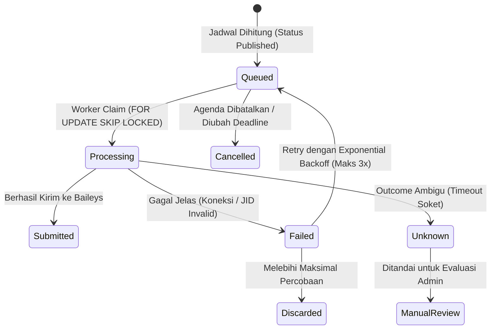

# Reminder Engine Architecture & Scheduling Policy

> **Status:** Approved Baseline Policy (WAJIB & FINAL)  
> **Source of Truth:** MASTER_PROMPT.md V3.2 (Section 7)

---

## 1. Kebijakan Empat Pemicu Logis (Mandatory 4 Triggers)

Setiap agenda berstatus `published` yang memiliki `deadline` wajib menghasilkan maksimal empat pemicu logis:

| No | Pemicu (Trigger Type) | Rumus Waktu Eksekusi (WIB) | Karakteristik & Presisi |
|---|---|---|---|
| 1 | **H-7** | `Tanggal_Deadline - 7 hari` @ **08.00.00 WIB** | Kalender harian, jam 8 pagi WIB. |
| 2 | **H-3** | `Tanggal_Deadline - 3 hari` @ **08.00.00 WIB** | Kalender harian, jam 8 pagi WIB. |
| 3 | **H-1** | `Tanggal_Deadline - 1 hari` @ **08.00.00 WIB** | Kalender harian, jam 8 pagi WIB. |
| 4 | **T-3 JAM** | `Waktu_Deadline_Presisi - 3 jam` | **Presisi menit**, tepat 180 menit sebelum batas pengumpulan. |

> [!IMPORTANT]
> **Kebijakan Penggabungan (Batching 08.00 WIB):**
> Jika pada pukul 08.00 WIB suatu grup menerima beberapa pemicu H-7, H-3, atau H-1 sekaligus dari agenda yang berbeda, pesan dapat digabungkan menjadi satu pesan ringkasan harian rapi untuk mencegah spamming. Namun, setiap agenda tetap tercatat sebagai pemicu logis independen di database.  
> **Pengingat T-3 Jam tidak boleh ditunda atau digabung ke jam lain!**

---

## 2. Algoritma Perhitungan Waktu Pemicu (Contoh Konkret)

**Skenario:**  
Deadline Tugas: **Jumat, 30 Oktober 2026 pukul 23.59 WIB** (`2026-10-30T16:59:00Z`).

1. **H-7**: Jumat, 23 Oktober 2026 pukul 08.00 WIB (`2026-10-23T01:00:00Z`).
2. **H-3**: Selasa, 27 Oktober 2026 pukul 08.00 WIB (`2026-10-27T01:00:00Z`).
3. **H-1**: Kamis, 29 Oktober 2026 pukul 08.00 WIB (`2026-10-29T01:00:00Z`).
4. **T-3 JAM**: Jumat, 30 Oktober 2026 pukul 20.59 WIB (`2026-10-30T13:59:00Z`).

### Aturan Lewati Masa Lalu (Skip Past Triggers)
Bila agenda baru disetujui pada **28 Oktober 2026 pukul 10.00 WIB**:
- Pemicu H-7 (23 Okt) dan H-3 (27 Okt) **sudah lewat**, sehingga otomatis **dilewati** (`skipped`).
- Sistem **hanya** menjadwalkan:
  - H-1: 29 Oktober 2026 pukul 08.00 WIB.
  - T-3 Jam: 30 Oktober 2026 pukul 20.59 WIB.
- **Dilarang keras melakukan pengiriman susulan (burst catch-up spam)** untuk pemicu yang terlewat.

---

## 3. Format Pesan WhatsApp Standar

### 3.1 Pesan Tunggal
```text
📚 NOVARION — PENGINGAT AKADEMIK
[H-1 | DEADLINE BESOK]

Mata Kuliah : Analisis Regresi Terapan
Agenda      : Pengumpulan Laporan Praktikum Modul 3
Deadline    : Jumat, 30 Oktober 2026 — 23:59 WIB
Cakupan     : Kelas A

Detail & Instruksi:
https://novarion.hub/app/agendas/550e8400-e29b-41d4-a716-446655440000

Semangat menyelesaikan sebelum batas waktu! 🚀
```

### 3.2 Pesan Gabungan Pagi (08.00 WIB)
```text
📚 NOVARION — RINGKASAN DEADLINE PAGI INI
Pukul 08:00 WIB • Jumat, 23 Oktober 2026

Berikut agenda yang mendekati batas waktu:

1. [H-3] Komputasi Statistika — Tugas Pemrograman R
   Deadline: Senin, 26 Okt 2026 — 23:59 WIB
   Detail: https://novarion.hub/app/agendas/123

2. [H-7] Teori Peluang — Latihan Soal Bab 4
   Deadline: Jumat, 30 Okt 2026 — 23:59 WIB
   Detail: https://novarion.hub/app/agendas/456

Periksa checklist dan instruksi lengkap di Novarion Academic Hub.
```

---

## 4. Siklus Hidup Job & Pengendalian Worker Konkurensi



1. **Locking & Concurrency**:
   - Worker menggunakan transaksi PostgreSQL dengan klausa `FOR UPDATE SKIP LOCKED`.
   - Menetapkan batas lease (`locked_until = NOW() + INTERVAL '5 minutes'`) dan `locked_by = worker_instance_id`.
2. **Penanganan Status `Unknown`**:
   - Jika soket terputus saat payload dikirimkan, pesan mungkin sudah atau belum sampai ke server WhatsApp.
   - Status diset ke `unknown` dan **TIDAK di-retry otomatis secara membabi buta** guna mencegah pengiriman ganda ke grup angkatan.
3. **Pemeriksaan Kill Switch**:
   - Tepat sebelum pemanggilan `baileys.sendMessage()`, worker memverifikasi field `is_paused` pada tabel `whatsapp_connections`. Jika aktif, job ditunda dan pengiriman dibatalkan.
