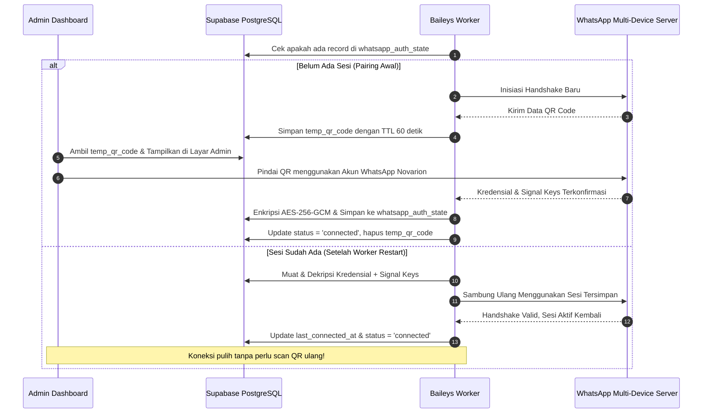

# WhatsApp Gateway & Baileys Risk Management

> **Status:** Approved Baseline Assessment  
> **Source of Truth:** MASTER_PROMPT.md V3.2 (Section 8 & 12)

---

## 1. Analisis Risiko Integrasi Baileys (API Tidak Resmi)

Aplikasi menggunakan `@whiskeysockets/baileys` untuk berkomunikasi dengan protokol WhatsApp Web. Ini adalah integrasi **tidak resmi (reverse-engineered)** yang memiliki karakteristik dan risiko operasional nyata:

| Kategori Risiko | Deskripsi Potensi Masalah | Mitigasi Desain Arsitektur Novarion |
|---|---|---|
| **Pemblokiran Akun (Ban)** | WhatsApp dapat membatasi atau memblokir nomor yang terdeteksi mengirim pesan otomatis atau massal. | 1. Gunakan **nomor WhatsApp khusus angkatan**, bukan nomor pribadi pengurus. 2. Rate limiting dan jeda alami antar pesan. 3. Tidak menggunakan teknik *anti-ban evasion* ilegal. 4. Bot hanya mengirim ke grup resmi yang telah disetujui admin grup. |
| **Perubahan Protokol** | Meta rutin memperbarui handshake, skema enkripsi Signal, atau versi WhatsApp Web. | 1. Abstraksi `MessagingProvider` yang dapat diganti sewaktu-waktu. 2. Sediakan `MockMessagingProvider` untuk testing dan staging. 3. Pembaruan library berkala dari upstream repository. |
| **Sesi Terputus (Revocation)** | Sesi multi-device dicabut oleh pengguna atau kedaluwarsa setelah 14 hari tidak aktif. | 1. Deteksi event status `logged_out` atau `connection.closed`. 2. Tandai status koneksi sebagai `requires_repair`. 3. Tampilkan peringatan jelas di admin dashboard agar admin memindai QR baru. |
| **Server Restart & Downtime** | Server homelab mengalami reboot berkala atau mati listrik. | 1. **SQL-backed Encrypted Signal Auth State**: Sesi tersimpan aman di database PostgreSQL. 2. Auto-reconnect saat service menyala kembali tanpa scan QR ulang. 3. Lewati reminder yang jatuh tempo saat server offline (tidak ada burst catch-up). |
| **Kebocoran Kunci Enkripsi** | Kunci Signal dan token sesi bocor ke pihak tidak berwenang. | 1. Kunci dienkripsi AES-256-GCM sebelum disimpan di tabel `whatsapp_auth_state`. 2. Master encryption key hanya ada di environment server worker. 3. Tidak ada endpoint publik atau RLS akses client ke tabel sesi. |

---

## 2. Mekanisme Sekali Scan (Persistent Multi-Device Auth)

Berbeda dari implementasi prototipe yang memakai file sistem lokal (`useMultiFileAuthState`), Novarion menerapkan **SQL-backed Authentication State**:

---

## 3. Fitur Keamanan & Kendali Darurat

1. **Emergency Kill Switch (`is_paused`)**:
   Admin dapat menekan tombol `Jeda Seluruh Pengiriman` di dashboard admin. Saat bernilai `true`, worker menghentikan pengiriman pesan outbound seketika tanpa memutuskan koneksi WhatsApp.
2. **Uji Coba Terkendali (`Test Message`)**:
   Sebelum mengaktifkan pengiriman otomatis, admin dapat mengirimkan satu pesan tes berformat resmi ke grup tujuan yang dipetakan. Tindakan ini dibatasi oleh rate limit server (maksimal 1 pesan per 30 detik).
3. **Pemberitahuan Transparan**:
   Saat bot pertama kali diundang ke grup angkatan atau kelas, admin memberikan pengumuman singkat bahwa akun ini adalah bot resmi pengingat akademik Novarion.
